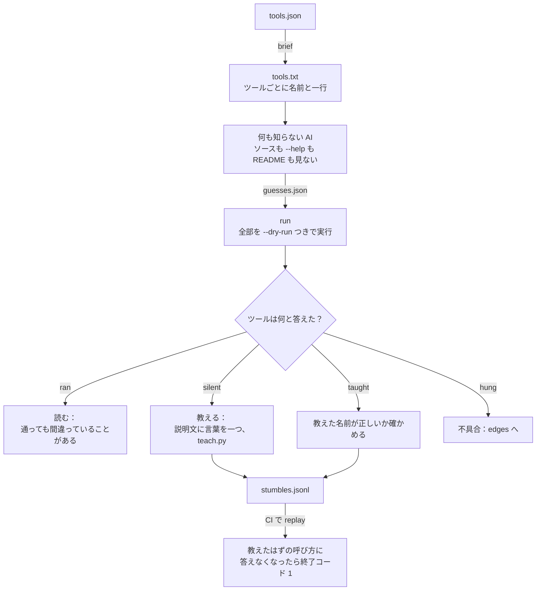

<h1 align="center">first-try</h1>

<p align="center"><b>あなたのコマンドラインツールは、説明書を読んでいない AI が初見で正しく使えますか？</b><br>
何も知らない AI に呼び方を推測させ、<code>first-try</code> がそれを実行し、外れを一つずつ「ツールが返す答え」と「それを守るテスト」に変えます。<br>
どのコマンドラインツールにも使える · Python 標準ライブラリだけ · API キー不要</p>

<p align="center">
  <a href="#使ってみる"><b>使ってみる</b></a> ·
  <a href="#しくみ"><b>しくみ</b></a> ·
  <a href="#コマンド">コマンド</a> ·
  <a href="#スキル">スキル</a> ·
  <a href="#実際のツール群で測った結果">結果</a> ·
  <a href="#よくある質問">よくある質問</a> ·
  <a href="README.md">English</a>
</p>

<p align="center">
  <a href="https://github.com/kajisho5/first-try/actions/workflows/tests.yml"></a>
  
  
  <a href="LICENSE"></a>
  <a href="https://github.com/sponsors/kajisho5"></a>
</p>

```bash
python3 first_try.py brief  tools.json                  # 何も知らない AI に見せる一覧
python3 first_try.py run    tools.json guesses.json     # AI が書いた呼び方を実行
python3 first_try.py edges  tools.json                  # 全オプションに 0・-1・巨大な値を入れる
python3 first_try.py replay tools.json stumbles.jsonl   # つまずきの台帳をテストとして再生
```

| 最初の測定（[ffmpeg-skill](examples/ffmpeg-skill/README.md) の AI 向けツール 42 本） | |
|---|---|
| 初見の呼び方のうち、通ったもの | **126 件中 27 件** |
| そのうち、通ったのに結果が間違っていたもの | **1 件** |
| 存在しないオプションを打った呼び方に、正しいオプションを返せた数（直す前 → 直した後） | **64 件中 33 → 49 件** |
| 端の値で返事がなくなったもの | **558 件中 1 件** |

テストは、作者が知っている書き方でツールを呼びます。AI は一行の説明だけを読んで、「たぶんこう
いう名前だろう」と打ちます。`first-try` はその差を測り、外れた呼び方を一つずつ「二度と外れない
状態」にします。

---

**目次**
[なぜ必要か](#なぜ必要か) · [使ってみる](#使ってみる) · [しくみ](#しくみ) · [守っている決まり](#守っている決まり) · [コマンド](#コマンド) · [外れを教える](#外れを教える) · [直しっぱなしにしない](#直しっぱなしにしない) · [スキル](#スキル) · [実際のツール群で測った結果](#実際のツール群で測った結果) · [よくある質問](#よくある質問) · [関連するもの](#関連するもの) · [動かすのに必要なもの](#動かすのに必要なもの) · [開発](#開発) · [ファイル一覧](#ファイル一覧) · [応援する](#応援する)

---

## なぜ必要か

AI 向けのツールは、たいてい作者がテストします。作者はオプション名を全部知っています。でも、
実際に呼ぶ AI は知りません。名前と一行の説明を読んで、その種のツールに慣れた人が打ちそうな
名前を打ちます。あなたが `--degrees` と書いたところに `--angle`、`--aspect` のところに
`--ratio`、という具合です。

- **外れは測れます。** 一行の説明だけを何も知らない AI に渡し、書いた呼び方を実行すれば、
  「通った数」が出ます。これはテストでは決して見えない数字です。
- **一番悪い外れは、エラーなしで通ります。** argparse（Python 標準のオプション読み取り部品）は
  オプション名の書きかけを補うので、`--time 3` が黙って `--timeout 3` になることがあります。
  通った呼び方は、数えるのではなく読む必要があります。
- **外れは AI の不具合ではなく、ツールの性質です。** 3 つの AI が `--angle` と打つなら、ツールが
  `--degrees` だと答えればよいのです。一番安い直し方は、説明文に言葉を一つ足すことです。
- **直したら、直ったままにします。** 外れは台帳に書き、CI（自動テスト）が毎回再生します。次に
  同じことを打った AI には、正しい名前が返ります。

## 使ってみる

インストールは不要です。リポジトリを取ってきて、Python 3.10 以上で動かします。以下はすべて、
小さな試験用ツール [`tests/toy.py`](tests/toy.py)（`--degrees`、`--fill-color`、`--count`、
`--timeout` を持つ）を相手に、リポジトリの一番上のフォルダで実際に動かした結果です。

```bash
git clone https://github.com/kajisho5/first-try && cd first-try
```

**1. 何も知らない AI に見せてよい一覧を作る**

```console
$ python3 first_try.py brief examples/toy/tools.json
toy: Rotate a picture by an angle.
toy-plain: The same tool, without teach.
```

**2. AI が書いた呼び方を実行する**（[`examples/toy/guesses.json`](examples/toy/guesses.json)：
両方のツールに同じ 3 つの推測。うち 2 つは、ツールにないオプションを使っています）

```console
$ python3 first_try.py run examples/toy/tools.json examples/toy/guesses.json
6 calls: 2 ran, 2 taught, 2 silent, 0 refused
silent   toy-plain {clip} --angle 5  (tilt the picture 5 degrees)
silent   toy-plain {clip} --degrees 10 --fill-colour white  (rotate 10 degrees, white corners)
```

`toy` には `teach.install(parser)` が入っているので、2 つの外れは `taught`（正しい名前を教えた）
になります。`toy-plain` は同じツールから `teach` を外したもので、役に立つことを何も言いません。
`toy` はこう答えます。

```console
$ python3 tests/toy.py in.png --angle 5 --dry-run
toy.py: error: the following arguments are required: --degrees
--angle is not an option of this tool; --degrees mention 'angle'
```

**3. 端の値を試す：値を取る全オプションに 0・-1・1000000000 を入れる**

```console
$ python3 first_try.py edges examples/toy/tools.json --only toy --timeout 5
12 calls: 1 refused, 10 ran, 1 hung
hung     toy --count=1000000000
ran      toy --count=0
...
```

**4. 台帳をテストとして再生する。** 教えたはずの呼び方に答えなくなったら、終了コード 1 で落ちます。

```console
$ python3 first_try.py replay examples/toy/tools.json examples/toy/stumbles.jsonl
1 taught lines replayed, 0 missed
```

### 自分のツールで試す

`tools.json` にツールを書きます（書式の全体は [`first_try.py`](first_try.py) の先頭にあります）。

```json
{"placeholders": {"clip": "sample.mp4"},
 "always": ["--dry-run"],
 "tools": [{"name": "cut",
            "run": ["python3", "scripts/cut.py"],
            "base": ["{clip}", "--start", "0", "--end", "1"],
            "output": ["-o", "{tmp}/out.mp4"]}]}
```

| 項目 | 意味 |
|---|---|
| `placeholders` | 引数の中の `{clip}` などに入れる値。`{tmp}` は毎回新しく作る一時フォルダ |
| `always` | すべての呼び方の最後に足す引数。実際の処理が走らないようにする（`--dry-run` など） |
| `run` | ツールの起動のしかた |
| `about` | 省略可。一覧に出す一行。省略すると `--help` の最初の段落（使い方の行を除く） |
| `base` | 最小限の正しい呼び方。`edges` で使う |
| `output` | 省略可。すべての呼び方に足す引数 |

そのあと：

1. `python3 first_try.py brief tools.json > tools.txt`
2. `tools.txt` **だけ**を、何も知らない AI に渡します。ツールごとに現実的な依頼を 3 つ考えさせ、
   最初に打つ引数を JSON（`[{"tool", "request", "argv"}]`）で書かせます。
3. `python3 first_try.py run tools.json guesses.json` を実行し、全部の行を読みます。読むのは
   `ran`（通った）から先に。

## しくみ



推測を書く AI は、コードを知っている AI であってはいけません。`--help` を読んだ時点で名前を
知ってしまうので、答えを知っている推測では何も測れません。

## 守っている決まり

1. **推測は見ないで書く。** 推測する AI が読めるのは `tools.txt` だけです。呼び方を書くだけで、
   実行はしません。
2. **通った行から先に読む。** エラーなしで通った間違いが一番悪く、数字には出ません。`ran` は
   合格ではなく、`refused` は失敗ではありません。人か AI が読んで決めます。
3. **名前を増やさずに教える。** 人が使いがちな言葉を、正しいオプションの説明文に入れます。
   推測ごとに別名を足したり、推測に合わせて名前を変えたりはしません。
4. **あいまいな推測は、ないより悪い。** `teach.py` は説明文で見つけたものを「mention（説明に
   出てくる）」と言い、「did you mean（もしかして）」とは言いません。
5. **外れは全部書き残す。** つまずき 1 件を JSON 1 行にし、`taught` か `open` を付けて CI で再生します。
6. **前回の推測を次の測定に使い回さない。** それはもう台帳に入っています。次の回は別の AI や
   モデルに推測させます。推測が変わることに意味があります。
7. **`ran` が増えただけでは前進ではない。** 間違った呼び方が通るようになる変更は、後退です。

## コマンド

| コマンド | すること | 表示 |
|---|---|---|
| `brief tools.json` | ツールごとの名前と一行の説明を出す | ツールごとに 1 行 |
| `run tools.json guesses.json` | 推測した呼び方を全部実行し、ツールの答えで仕分ける | 件数と、`silent`・`hung` の行 |
| `edges tools.json` | `--help` で値を取ると分かる全オプションに、`base` の呼び方の上で 0・-1・1000000000 を一つずつ入れる | 件数と、`hung`・`ran` の行（断るのが正しい答えなので、断った行は出さない） |
| `replay tools.json stumbles.jsonl` | 台帳の `taught` の行を全部実行し、答えに `must_say` が全部入っているか確かめる | 外れた行。1 つでもあれば終了コード 1 |

どのコマンドも `--timeout 秒数`（何秒で「返事なし」とみなすか。初期値 45）と `--json`（全部の行
をツールの答えつきで出す）が使えます。`edges` は `--only a,b` でツールを絞れます。

| 行 | 意味 |
|---|---|
| `ran` | 通った（終了コード 0）。必ず読むこと。通ったのに間違っている場合があります |
| `taught` | 知らないオプションに対し、ツールの答えがその名前と、ツール自身の正しいオプションを挙げた |
| `silent` | 知らないオプションに対し、ツールのオプションを何も教えなかった |
| `refused` | それ以外の理由で断った（ファイルがない、値が範囲外など） |
| `hung` | 時間内に返事がなかった |

## 外れを教える

```python
import teach
teach.install(parser)
```

[`teach.py`](teach.py) は、argparse のエラー表示を包みます。コマンドラインにあるのにパーサーが
知らない `--オプション` ごとに、エラーに 1 行足して、次のものを挙げます。

- 言葉を共有するオプション（`--fill-colour` → `--fill-color`）
- それがなければ、綴りの近いオプション（`--treshold` → `--threshold`）
- 説明文にその言葉が出てくるオプション（`--angle` → `--degrees mention 'angle'`）

必須のオプションが足りないとき、argparse はそれしか言わず、知らないオプションまで見ません。
`teach` はその場合も教えます。なので一番安い直し方は、説明文に言葉を一つ足すことです。
`help="rotation angle in degrees"` と書いてあるから、`--angle` から `--degrees` が見つかります。

## 直しっぱなしにしない

外れは 1 件ずつ、JSON 1 行で `stumbles.jsonl` に書きます。

```json
{"tool": "toy", "argv": ["{clip}", "--angle", "5"], "got": "only: --degrees is required", "right": "--degrees 5", "must_say": ["--angle is not an option", "--degrees"], "status": "taught"}
```

| 項目 | |
|---|---|
| `tool`、`argv` | AI が書いたとおりの呼び方 |
| `got` | 直す前にツールが言ったこと |
| `right` | 依頼どおりに動く呼び方 |
| `must_say` | これからツールの答えに必ず入っていなければならない文字 |
| `status` | `taught`（再生する）か `open`（まだ答えがない。黙って間違った結果を出すものなど） |

あとは CI に 1 行足します。

```yaml
- run: python3 first_try.py replay tools.json stumbles.jsonl
```

## スキル

同じ手順を AI 向けに書いたものが、2 つの [Agent Skill](https://docs.anthropic.com/en/docs/agents-and-tools/agent-skills)
（普通の `SKILL.md`）として入っています。フォルダごと、お使いのエージェントのスキル置き場
（Claude Code なら `.claude/skills/`）にコピーしてください。

| スキル | 使う場面 | 手順 |
|---|---|---|
| [`first-try-probe`](skills/first-try-probe/SKILL.md) | CLI が AI にとって使いやすいか聞かれたとき、ツールを安定版と呼ぶ前、オプションを足したり名前を変えたりした後、「AI が何度もオプション名を間違える」と言われたとき | ツールを書く → 一覧を作る → 何も知らない AI が推測 → 実行 → `ran` から読む → 仕分け → 教える → 記録 → もう一度測り、前後の数字を両方報告 |
| [`edge-probe`](skills/edge-probe/SKILL.md) | まだ誰も報告していない不具合を探すとき、数値のオプションを足した後、「止まった」「変なファイルができた」「おかしな値を受け付けた」と言われたとき | `base` を書く → `edges` → 説明文で決まっているものを除く → 残りを時間制限つきで本当に実行 → 手間のかからない性質を確かめる（2 回やっても変わらない、逆の操作で形が戻る）→ 共通の場所で直す |

## 実際のツール群で測った結果

この方法は、[ffmpeg-skill](https://github.com/kajisho5/ffmpeg-skill)（AI 向けに作った FFmpeg の
Python ツール 42 本）での 2026-11-20 の 1 回の測定から生まれました。各ツールの名前と一行の説明
しか見ていない AI が、ツールごとに 3 つの呼び方を書きました。

| 結果 | 測ったもの |
|---|---|
| **126 件中 27 件** | 何も変える前に、初見の呼び方で通ったもの |
| **64 件中 33 件** | ツールにないオプションを使った呼び方のうち、正しいオプションを返せたもの |
| **64 件中 49 件** | 同じ 64 件を、説明文と共通のヒント 1 つを直した後に測ったもの |
| **断った 344・通った 213・返事なし 1** | 28 本のツールの全数値オプションに端の値（0、-1、1000000000）を入れた 558 件 |

数字には出ず、行を読んで分かったこと：

- **通ったのに間違っていた呼び方。** `freeze.py --time 3 --hold 1` は終了コード 0 でした。
  argparse が `--time` を `--timeout` の書きかけとして読み、3 秒の時間制限がかかり、3 秒の
  コマではなく最後のコマを止め、何も言いませんでした。argparse は、この補完を止めていない
  すべてのパーサーで、一つに決まる書きかけを補います。
- **止まってしまうオプションが 2 つ。** `cropdetect.py --samples 1000000000` と
  `graphics.py --template countdown --from 1000000000` は返事がありませんでした。
- **外れのほとんどは、AI のせいではありませんでした。** 同じものがツールによって別の名前だったり
  （角度が `--angle`、`--rotate`、`--degrees`）、一つの名前が別の意味だったり（`--scale` が
  あるツールではピクセル、別のツールでは倍率）しました。

126 件の推測と 78 行の台帳は [examples/ffmpeg-skill](examples/ffmpeg-skill/README.md) にあります。

## よくある質問

### 推測を自分で書いてもいいですか？

だめです。ソースや `--help` を読んだ時点で名前を知ってしまうので、答えを知っている推測では
何も測れません。そのプロジェクトを何も知らない AI に書かせてください。

### うちのツールは argparse を使っていません。

`first_try.py` はどんなコマンドでも実行し、終了コードと出力を読むだけなので、`brief`・`run`・
`edges`・`replay` は `--help` がある CLI ならどれでも使えます。`teach.py` は argparse 用ですが、
考え方は、エラー処理を差し替えられるパーサーならどれでも同じように使えます。

### なぜ `ran` は合格ではないのですか？

一番悪い外れは通ってしまうからです。最初の測定では、通った 27 件のうち 1 件が、黙って違うことを
していました。`ran` の行は、元の依頼と見比べて読んでください。

### `edges` は、どのオプションが数値か分かりますか？

分かりません。`--help` で値を取ると分かるオプションを全部試すので、文字を取るオプションが
"0" を文字として受け取れば `ran` になります。説明文で決まっているものは除いてください。詳しくは
[edge-probe](skills/edge-probe/SKILL.md) スキルにあります。

### 自分のファイルが書き換わりませんか？

ツール次第です。ツールの「実際には何もしない」オプション（`--dry-run` など）を `always` に書くか、
作業用のフォルダに向けてください。`{tmp}` はコマンドごとに新しく作る一時フォルダです。

## 関連するもの

「何も知らないモデルに道具を使わせて、つまずきを見る」という考え方は新しくありません。
[Fresh Eyes as a Service](https://recursion.wtf/posts/llms_as_ux_testers/) は CLI の使いやすさに
ついてこれを書いています。[cli-agent-lint](https://github.com/Camil-H/cli-agent-lint) は CLI を
AI 向けの決まりに照らして調べ、[AXI](https://github.com/kunchenguid/axi) は AI が呼ぶ道具の設計
原則です。端の値の手順は Trail of Bits の `sharp-edges` と `property-based-testing` の
[スキル](https://github.com/trailofbits/skills)にならっています。

ここで足したのは、その先です。外れを「ツールが返す答え」に変え、テストが再生する台帳に残すので、
次に同じことを打った AI には正しい名前が返ります。

## 動かすのに必要なもの

- Python 3.10 以上。標準ライブラリだけ（CI は 3.10 と 3.13 で動かしています）
- 測りたいツールと、それが動くのに必要なもの
- 推測を書く、そのプロジェクトを何も知らない AI

## 開発

```bash
python3 -m unittest discover -s tests
```

テストは、`first-try` が探す欠点をわざと持たせた小さなツール [`tests/toy.py`](tests/toy.py) を
相手に、`first_try.py` と `teach.py` を動かします。

## ファイル一覧

| | |
|---|---|
| [`first_try.py`](first_try.py) | 4 つのコマンド。`tools.json` の書式は先頭にあります |
| [`teach.py`](teach.py) | argparse に「打ち間違えたオプション名に、正しい名前を返す」機能を足す |
| [`skills/first-try-probe`](skills/first-try-probe/SKILL.md) | 推測の手順書（AI 向け） |
| [`skills/edge-probe`](skills/edge-probe/SKILL.md) | 端の値の手順書（AI 向け） |
| [`examples/toy`](examples/toy) | 「使ってみる」の `tools.json`・推測・台帳 |
| [`examples/ffmpeg-skill`](examples/ffmpeg-skill/README.md) | 元になった測定。126 件の推測と台帳つき |
| [`tests/`](tests) | テストと試験用ツール |

## 応援する

役に立ったら、[GitHub Sponsors](https://github.com/sponsors/kajisho5) で開発を支えていただけます。不具合の報告や改善の提案（Issue・Pull Request）も歓迎です。

## ライセンス

[MIT](LICENSE) · [English](README.md)
