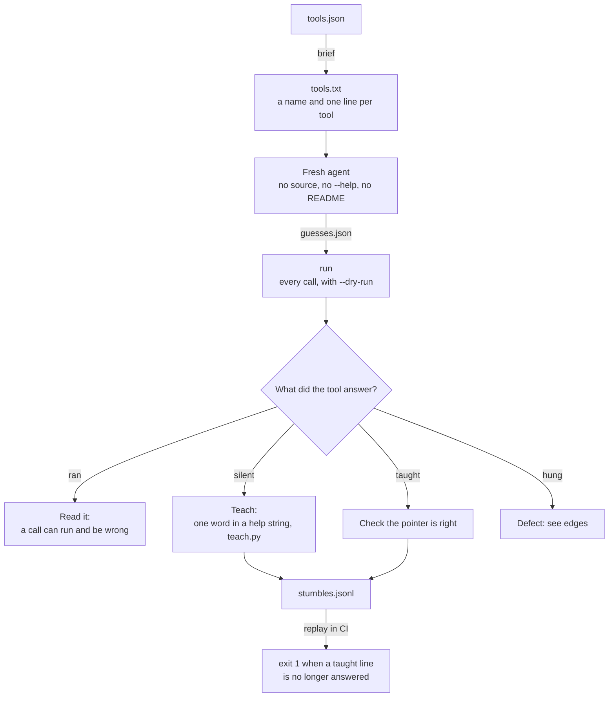

<h1 align="center">first-try</h1>

<p align="center"><b>Can an agent that has not read your docs use your command-line tools on the first try?</b><br>
A fresh agent guesses the calls, <code>first-try</code> runs them, and every miss becomes an answer the tool gives and a test that keeps it.<br>
Any command-line tool · Python standard library · No API keys</p>

<p align="center">
  <a href="#quick-start"><b>Quick start</b></a> ·
  <a href="#how-it-works"><b>How it works</b></a> ·
  <a href="#commands">Commands</a> ·
  <a href="#skills">Skills</a> ·
  <a href="#tested-on-a-real-tool-set">Results</a> ·
  <a href="#faq">FAQ</a> ·
  <a href="README.ja.md">日本語</a>
</p>

<p align="center">
  <a href="https://github.com/kajisho5/first-try/actions/workflows/tests.yml"></a>
  
  
  <a href="LICENSE"></a>
  <a href="https://github.com/sponsors/kajisho5"></a>
</p>

```bash
python3 first_try.py brief  tools.json                  # what a blind agent may read
python3 first_try.py run    tools.json guesses.json     # run the calls it wrote
python3 first_try.py edges  tools.json                  # 0, -1 and a huge value on every option
python3 first_try.py replay tools.json stumbles.jsonl   # the ledger of misses, as a test
```

| First round, on [ffmpeg-skill](examples/ffmpeg-skill/README.md)'s 42 agent tools | |
|---|---|
| Blind calls that ran | **27 / 126** |
| ... and of those, ran and were wrong | **1** |
| Calls with an unknown option that were pointed at the right one, before → after | **33 → 49** of 64 |
| Edge values that hung a tool | **1** of 558 |

Your tests call each tool the way you spell it. An agent reads one line about the tool and types
what it expects the option to be called. `first-try` measures that gap, and turns every miss into
something that stays fixed.

---

**Contents**
[Why](#why) · [Quick start](#quick-start) · [How it works](#how-it-works) · [Design principles](#design-principles) · [Commands](#commands) · [Teach a miss](#teach-a-miss) · [Keep it fixed](#keep-it-fixed) · [Skills](#skills) · [Tested on a real tool set](#tested-on-a-real-tool-set) · [FAQ](#faq) · [Related work](#related-work) · [Requirements](#requirements) · [Development](#development) · [Files](#files) · [Support](#support)

---

## Why

A tool built for agents is usually tested by its author, who knows every option name. The agent
that will call it does not. It reads a name and one line, and types what an experienced user of
that kind of tool would type: `--angle` where you wrote `--degrees`, `--ratio` where you wrote
`--aspect`.

- **The miss is measurable.** Give a fresh agent only the one-line brief and run what it writes.
  The count of calls that ran is the number your tests never show.
- **The worst miss exits 0.** argparse completes an unambiguous start of an option name, so
  `--time 3` can quietly become `--timeout 3`. A call that ran has to be read, not counted.
- **A miss is a property of the tool, not a bug in the agent.** If three agents type `--angle`,
  the tool can answer with `--degrees`, and the cheapest fix is often one word in a help string.
- **A fix should stay fixed.** Each miss goes into a ledger that CI replays, so the next agent that
  types the same thing is told.

## Quick start

Nothing to install: clone the repository and run it with Python 3.10 or newer. Everything below
runs as shown, on the small tool in [`tests/toy.py`](tests/toy.py) (`--degrees`, `--fill-color`,
`--count`, `--timeout`), from the repository root.

```bash
git clone https://github.com/kajisho5/first-try && cd first-try
```

**1. The brief: all a blind agent may read.**

```console
$ python3 first_try.py brief examples/toy/tools.json
toy: Rotate a picture by an angle.
toy-plain: The same tool, without teach.
```

**2. Run the calls an agent wrote** ([`examples/toy/guesses.json`](examples/toy/guesses.json): the
same three guesses for both tools, two of them with an option the tool does not have).

```console
$ python3 first_try.py run examples/toy/tools.json examples/toy/guesses.json
6 calls: 2 ran, 2 taught, 2 silent, 0 refused
silent   toy-plain {clip} --angle 5  (tilt the picture 5 degrees)
silent   toy-plain {clip} --degrees 10 --fill-colour white  (rotate 10 degrees, white corners)
```

`toy` has `teach.install(parser)`, so its two misses are `taught`; `toy-plain` is the same tool
without it, and says nothing useful. This is what `toy` answers:

```console
$ python3 tests/toy.py in.png --angle 5 --dry-run
toy.py: error: the following arguments are required: --degrees
--angle is not an option of this tool; --degrees mention 'angle'
```

**3. Edge values: 0, -1 and 1000000000 on every option that takes a value.**

```console
$ python3 first_try.py edges examples/toy/tools.json --only toy --timeout 5
12 calls: 1 refused, 10 ran, 1 hung
hung     toy --count=1000000000
ran      toy --count=0
...
```

**4. The ledger as a test.** It exits 1 when a taught line is no longer answered.

```console
$ python3 first_try.py replay examples/toy/tools.json examples/toy/stumbles.jsonl
1 taught lines replayed, 0 missed
```

### Your own tools

Describe them in `tools.json` (the full format is at the top of [`first_try.py`](first_try.py)):

```json
{"placeholders": {"clip": "sample.mp4"},
 "always": ["--dry-run"],
 "tools": [{"name": "cut",
            "run": ["python3", "scripts/cut.py"],
            "base": ["{clip}", "--start", "0", "--end", "1"],
            "output": ["-o", "{tmp}/out.mp4"]}]}
```

| Key | What it does |
|---|---|
| `placeholders` | values for `{clip}` and friends in any argument; `{tmp}` is always a fresh temporary folder |
| `always` | appended to every call, so nothing real happens (`--dry-run` or its like) |
| `run` | how the tool is started |
| `about` | optional: the brief line; else the first paragraph of `--help` that is not the usage block |
| `base` | a minimal valid call, for `edges` |
| `output` | optional, added to every call |

Then:

1. `python3 first_try.py brief tools.json > tools.txt`
2. Give `tools.txt`, and nothing else, to a fresh agent. Ask it for three realistic requests per
   tool and the arguments it would type first, as JSON: `[{"tool", "request", "argv"}]`.
3. `python3 first_try.py run tools.json guesses.json`, and read every row, starting with `ran`.

## How it works



The agent that writes the guesses must not be the one that knows the code: once you have read
`--help` you know the names, and a guess that knows the answer measures nothing.

## Design principles

1. **Blind guesses only.** The guessing agent reads `tools.txt` and nothing else. It writes calls;
   it does not run them.
2. **Read the rows that ran first.** A wrong call that exits 0 is the worst outcome, and no count
   shows it. `ran` is not a pass and `refused` is not a failure until someone reads it.
3. **Teach without adding a name.** Put the word people reach for into the right option's help.
   Do not add an alias for every guess, and do not rename an option to match one.
4. **A loose guess is worse than none.** `teach.py` reports a help-text match as "mention", never
   as "did you mean".
5. **Every miss is written down.** One JSON line per stumble, `taught` or `open`, replayed in CI.
6. **Do not reuse a round's guesses as the next round's measurement.** They are in the ledger now.
   A different agent or model on the next round guesses differently, which is the point.
7. **More `ran` is not progress by itself.** A change that makes a wrong call succeed is a
   regression.

## Commands

| Command | What it does | Prints |
|---|---|---|
| `brief tools.json` | each tool's name and one line about it | one line per tool |
| `run tools.json guesses.json` | runs each guessed call and sorts it by what the tool answered | the counts, then the `silent` and `hung` rows |
| `edges tools.json` | gives every option the help shows taking a value 0, -1 and 1000000000, one at a time, on the `base` call | the counts, then the `hung` and `ran` rows (a refusal is the good answer) |
| `replay tools.json stumbles.jsonl` | runs every `taught` line of the ledger and checks the answer still says each `must_say` | the misses; exit 1 if any |

Every command takes `--timeout SECONDS` (when a call counts as hung, default 45) and `--json`
(every row, with the tool's answer). `edges` also takes `--only a,b`.

| Row | Meaning |
|---|---|
| `ran` | exit 0. Read these: a call can run and be wrong. |
| `taught` | an unknown flag, and the tool's answer names it and one of the tool's own options |
| `silent` | an unknown flag, and the answer does not point at an option of the tool |
| `refused` | any other refusal (a missing file, a value out of range) |
| `hung` | no answer in time |

## Teach a miss

```python
import teach
teach.install(parser)
```

[`teach.py`](teach.py) wraps an argparse parser's error. For each `--flag` on the command line
that the parser does not have, the usage error gains one line naming:

- the options that share a word with it (`--fill-colour` → `--fill-color`),
- else a near spelling (`--treshold` → `--threshold`),
- and the options whose help text uses the word (`--angle` → `--degrees mention 'angle'`).

It also speaks up when a required option is missing, where argparse names only that one and never
reaches the unknown flag. So the cheapest fix is often one word in a help string:
`help="rotation angle in degrees"` is what makes `--angle` find `--degrees`.

## Keep it fixed

Write each miss down, one JSON line, in `stumbles.jsonl`:

```json
{"tool": "toy", "argv": ["{clip}", "--angle", "5"], "got": "only: --degrees is required", "right": "--degrees 5", "must_say": ["--angle is not an option", "--degrees"], "status": "taught"}
```

| Field | |
|---|---|
| `tool`, `argv` | the call as the agent wrote it |
| `got` | what the tool said before the fix |
| `right` | the call that does what was asked |
| `must_say` | text the tool's answer has to contain from now on |
| `status` | `taught` (replayed) or `open` (no answer yet, such as a wrong result that says nothing) |

Then add one step to CI:

```yaml
- run: python3 first_try.py replay tools.json stumbles.jsonl
```

## Skills

The loop is also written for an agent, as two plain [Agent Skills](https://docs.anthropic.com/en/docs/agents-and-tools/agent-skills)
(`SKILL.md` files). Copy the folders into your agent's skills directory (`.claude/skills/` for
Claude Code).

| Skill | Use it when | The loop |
|---|---|---|
| [`first-try-probe`](skills/first-try-probe/SKILL.md) | asked how usable a CLI is for agents, before a tool is called stable, after options are added or renamed, or when an agent "kept guessing the wrong flag" | describe → brief → a fresh agent guesses → run → read `ran` first → sort → teach → record → run again and report both counts |
| [`edge-probe`](skills/edge-probe/SKILL.md) | looking for defects nobody has reported, after a numeric option is added, or when a tool "hung", "wrote a strange file" or "accepted nonsense" | `base` call → `edges` → drop what the help decides → run the rest for real under a timeout → check cheap properties (again changes nothing, an inverse returns the shape) → fix in the shared step |

## Tested on a real tool set

The method comes from one round on [ffmpeg-skill](https://github.com/kajisho5/ffmpeg-skill), 42
Python tools around FFmpeg made for coding agents, on 2026-11-20. An agent that had seen only each
tool's name and one line about it wrote three calls per tool.

| Result | Measurement |
|---|---|
| **27 / 126** | blind calls that ran, before any change |
| **33 / 64** | calls with an option the tool does not have that were pointed at the tool's own option |
| **49 / 64** | the same 64 after help strings and one shared hint changed |
| **344 refused, 213 ran, 1 hung** | edge values (0, -1, 1000000000) on every numeric option of 28 tools, 558 calls |

What the numbers did not show, and reading the rows did:

- **A call that ran and was wrong.** `freeze.py --time 3 --hold 1` exited 0. argparse had read
  `--time` as the start of `--timeout`: the run got a three second limit, froze the last frame
  instead of the one at 3 s, and said nothing. argparse does this for any unambiguous start of an
  option name, on every parser that has not turned it off.
- **Two options that hang.** `cropdetect.py --samples 1000000000` and
  `graphics.py --template countdown --from 1000000000` gave no answer.
- **The reason for most misses was not the agent.** The same thing had several names across the
  tools (an angle was `--angle`, `--rotate` and `--degrees`), and one name meant several things
  (`--scale` was pixels on one tool and a factor on another).

The 126 guesses and the 78-line ledger are in [examples/ffmpeg-skill](examples/ffmpeg-skill/README.md).

## FAQ

### Can I write the guesses myself?

No. Once you have read the source or `--help` you know the names, and a guess that knows the
answer measures nothing. A fresh agent with no context of the project writes them.

### My tool does not use argparse.

`first_try.py` runs any command and reads its exit code and output, so `brief`, `run`, `edges` and
`replay` work on any CLI that has `--help`. `teach.py` is for argparse. The method is not: any
parser with an error hook can name the right option in the same way.

### Why is `ran` not a pass?

Because the worst miss runs. In the first round, one of the 27 calls that ran did the wrong thing
and said nothing. Read each `ran` row against the request it came from.

### Does `edges` know which options are numbers?

No. It tries every option whose help shows it taking a value, so a text option that takes "0" as
text shows up as `ran`. Drop what the help already decides; see the
[edge-probe](skills/edge-probe/SKILL.md) skill.

### Will the calls change my files?

Only if the tool does. Put the tool's harmless-run flag (`--dry-run` or its like) under `always`,
or point the tools at a scratch folder. `{tmp}` is a fresh temporary folder on every command.

## Related work

The idea of handing a tool to a model with fresh eyes is not new.
[Fresh Eyes as a Service](https://recursion.wtf/posts/llms_as_ux_testers/) describes it for CLI
ergonomics. [cli-agent-lint](https://github.com/Camil-H/cli-agent-lint) checks a CLI against rules
for agent use, and [AXI](https://github.com/kunchenguid/axi) is a set of design principles for
tools agents call. The edge-value loop follows Trail of Bits' `sharp-edges` and
`property-based-testing` [skills](https://github.com/trailofbits/skills).

What this adds is the rest of the loop: the misses become answers the tool gives, and a ledger a
test replays, so the next agent that types the same thing is told.

## Requirements

- Python 3.10 or newer, standard library only (CI runs 3.10 and 3.13).
- The tools under test, and whatever they need to run.
- An agent with no context of the project, to write the guesses.

## Development

```bash
python3 -m unittest discover -s tests
```

The tests run `first_try.py` and `teach.py` against [`tests/toy.py`](tests/toy.py), a small tool
with the faults `first-try` looks for.

## Files

| | |
|---|---|
| [`first_try.py`](first_try.py) | the four commands, and the `tools.json` format at the top |
| [`teach.py`](teach.py) | makes an argparse parser answer a guessed option name with the right one |
| [`skills/first-try-probe`](skills/first-try-probe/SKILL.md) | the guessing loop, for an agent |
| [`skills/edge-probe`](skills/edge-probe/SKILL.md) | the edge-value loop, for an agent |
| [`examples/toy`](examples/toy) | the Quick start's `tools.json`, guesses and ledger |
| [`examples/ffmpeg-skill`](examples/ffmpeg-skill/README.md) | the round this came from, with its 126 guesses and its ledger |
| [`tests/`](tests) | the test suite and the toy tool |

## Support

If this saves you time, you can help keep it maintained through [GitHub Sponsors](https://github.com/sponsors/kajisho5). Issues and pull requests are just as welcome.

## License

[MIT](LICENSE) · [日本語の説明](README.ja.md)
